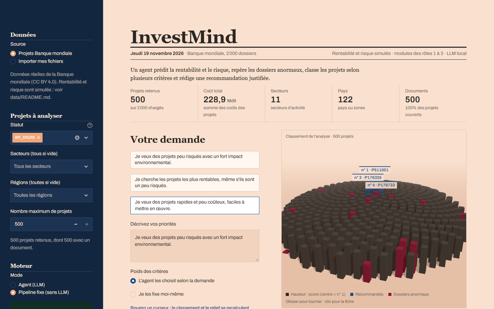
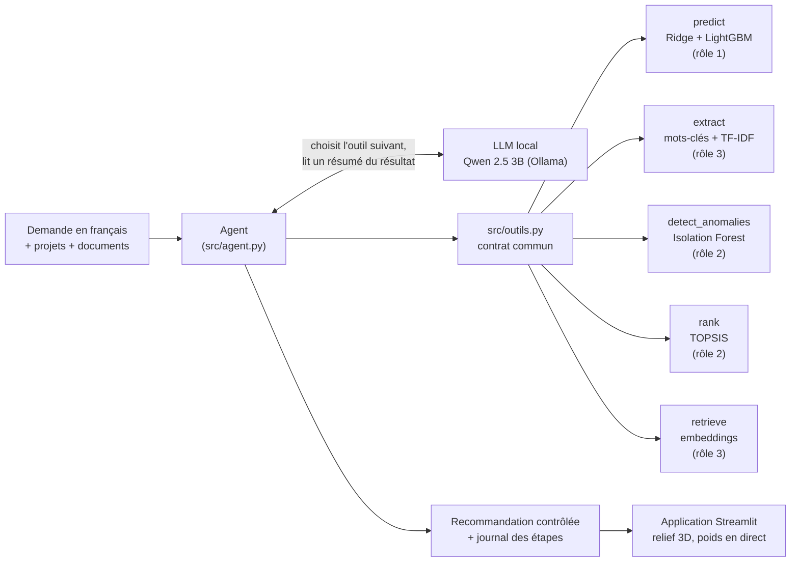
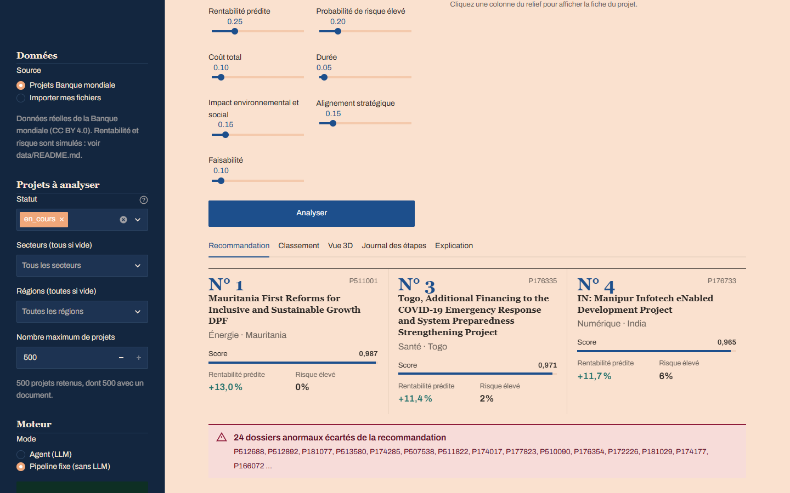

# InvestMind : un agent IA pour choisir des projets d'investissement

[](https://github.com/IlyasBBB/ia-agentique-investissement/actions/workflows/tests.yml)


[](LICENSE)

École Centrale Casablanca, novembre 2026. Équipe de quatre ingénieurs.

> **In English.** InvestMind is an AI agent that ranks investment projects and writes a justified recommendation. It runs fully offline: a local LLM (Qwen 2.5, 3B, via Ollama) plans the analysis and calls five tools built by the team, covering a supervised model (return and risk prediction, Ridge and LightGBM), an NLP module (criterion scoring with TF-IDF and keywords, passage retrieval with sentence embeddings), anomaly detection (Isolation Forest) and multi-criteria ranking (TOPSIS, AHP). It works on 2,000 real World Bank projects. The Streamlit app adds a 3D portfolio view and live re-weighting. Everything is tested (140 automated tests), evaluated without data leakage, and every choice of model was fixed before looking at the test set.



| 2 000 | 4 | 5 | 140 | 31 |
|:---:|:---:|:---:|:---:|:---:|
| projets réels de la Banque mondiale | domaines de l'IA réunis : supervisé, non supervisé, NLP, IA agentique | outils pilotés par un LLM local | tests automatiques | pull requests relues avant fusion |

## Le problème

Un comité d'investissement reçoit des centaines de dossiers : des chiffres (coût, durée, pays, secteur) et un texte (objectifs, composantes, montage). Il doit prédire ce que chaque projet rapportera et quel risque il porte, repérer les dossiers suspects, puis classer les projets selon ses propres priorités. Ces priorités changent d'une réunion à l'autre : « peu risqué d'abord », « impact environnemental avant tout ».

InvestMind prend une demande écrite en français, par exemple « Je veux des projets peu risqués avec un fort impact environnemental ». En une à deux minutes sur un PC portable, il rend les trois projets à retenir, les dossiers anormaux écartés, un passage des documents qui appuie le choix et le journal de chaque étape.

## Comment ça marche



Le LLM ne calcule rien. Il lit la demande, en tire l'importance des sept critères, appelle les outils dans l'ordre qu'il juge bon et rédige la recommandation. Tous les chiffres viennent des modèles de l'équipe, et le code vérifie ce que le LLM écrit :

- chaque outil traite tout le portefeuille d'un coup : le LLM ne voit jamais les 2 000 lignes, seulement un résumé de quelques lignes ;
- les étapes oubliées par le LLM sont lancées d'office, et les arguments qu'il invente sont ignorés ;
- une citation n'est acceptée que si elle figure mot pour mot dans un passage rendu par la recherche ; sinon le contrôle la signale et donne le vrai passage ;
- les projets ou les alertes oubliés dans le texte sont ajoutés par le contrôle ;
- si le LLM ne répond pas, ne termine pas en dix tours ou rend une réponse vide, l'agent finit sans lui et le dit.

Un **pipeline fixe** (les cinq outils dans le même ordre, sans LLM) sert de modèle de référence et de secours.

## Ce que l'équipe a construit

### Architecture, agent, application et intégration (Ilyas Ben Alla, responsable technique)

- **Architecture et contrat commun.** Découpage du produit en quatre modules, format exact de chaque fonction (`docs/contrat.md`, vérifié par `src/contrat.py`), fausses fonctions pour que chaque membre avance sans attendre les autres, branchement de chaque module dès sa livraison (`src/outils.py`, `MODULES_REELS`).
- **Jeu de données.** Téléchargement des 28 245 projets de la Banque mondiale, filtrage, tirage des 2 000 projets, documents texte, simulation documentée des cibles et injection des 40 anomalies de test (`scripts/`, `data/README.md`).
- **L'agent** (`src/agent.py`). Boucle écrite à la main avec l'appel d'outils d'Ollama, sans cadriciel ; outils qui traitent tout le portefeuille ; tous les garde-fous décrits plus haut ; choix du modèle après mesure (`qwen3:4b` écarté, 10 minutes par tour, au profit de `qwen2.5:3b`).
- **L'évaluation de l'agent.** Cinq scénarios (demandes variées, poids imposés, demande hors sujet), deux passages chacun, face au pipeline fixe, avec des vérifications automatiques de fidélité : chaque chiffre du texte doit venir d'un outil, chaque citation d'un document. Avec les quatre modules de l'équipe : passages cités dans 8 analyses sur 8, aucun chiffre ni aucune citation inventés, mêmes résultats aux deux passages, demande hors sujet refusée, poids adaptés à la demande dans 6 analyses sur 8, environ deux minutes par analyse sur un PC portable sans carte graphique. Analyse détaillée des erreurs et des corrections dans `reports/role4/tests_agent.md`.
- **L'application** (`app/`). Streamlit sur le thème d'un quotidien financier :
  - relief 3D du portefeuille, composant écrit en Three.js : une colonne cliquable par projet, qui se réordonne quand le classement change ;
  - poids modifiables en direct, sans relancer l'agent ;
  - journal des étapes, comparaison avec le pipeline fixe, graphique SHAP ;
  - aucun appel externe : LLM, polices et bibliothèque 3D sont sur la machine.
- **Intégration et revue.** Environnement de travail de chaque membre, protection de la branche `main`, relecture et fusion des 31 pull requests de l'équipe, arbitrage des choix de méthode (règles de choix fixées avant la mesure, pas de fuite de données), essais de bout en bout avec les quatre modules.



### Prédire la rentabilité et le risque (Salma Akazi, `src/supervise.py`)

Analyse exploratoire, séparation entraînement, validation et test (70 / 15 / 15) faite avant tout prétraitement, puis prétraitement dans un `Pipeline` scikit-learn (log du coût, standardisation, encodage des catégories, pays inconnu accepté). Modèles comparés : moyenne et classe majoritaire, régression linéaire, Ridge, Lasso, ElasticNet, forêt aléatoire, LightGBM, régression logistique, réglés par validation croisée à 5 plis. Le jeu de test a été ouvert une seule fois.

| Cible | Modèle retenu | Test | Référence |
|---|---|---|---|
| Rentabilité (hors valeurs aberrantes) | Ridge | R² 0,47 ; erreur moyenne 1,9 point | R² 0 |
| Risque (faible, moyen, élevé) | LightGBM | 67 % de bonnes classes ; F1 macro 0,66 ; AUC 0,88 | 40 % ; F1 0,19 |

Interprétabilité : valeurs SHAP, importance par permutation, analyse des dix plus grosses erreurs. Le modèle retrouve l'ordre des effets de la formule de simulation (secteur, puis durée, puis pays), et ses erreurs se concentrent sur les projets très courts et très longs, là où l'effet de la durée n'est pas linéaire.

### Lire les documents (Ayoub Asseffar, `src/nlp.py`)

- **`extract`** donne trois notes de 1 à 5 (impact environnemental et social, alignement stratégique, faisabilité) et la phrase qui justifie chaque note. Il n'existait pas de vérité terrain : l'équipe a écrit une grille de notation et noté 260 documents à la main, puis fait noter 900 documents par le LLM local pour l'entraînement. Le modèle livré combine des mots-clés tirés de la grille et une régression logistique sur TF-IDF. Sur les 100 documents de test : **kappa pondéré 0,66**, contre 0,52 pour le LLM lui-même et 0,49 pour TF-IDF seul. Il note les 2 000 documents en une dizaine de secondes.
- **`retrieve`** trouve les passages qui répondent à une question, avec des embeddings de phrases (`all-MiniLM-L6-v2`, en local). Sur 25 requêtes de test jugées à la main : **précision@3 de 0,75**, contre 0,55 pour TF-IDF.

### Repérer les dossiers anormaux et classer (Zineb Baghzali, `src/mcda.py`)

- **ACP** (3 axes, 70 % de la variance) et **clustering** avec quatre familles de méthodes (K-means, hiérarchique, DBSCAN, mélange gaussien). Résultat honnête : pas de groupes naturels nets (silhouette 0,20), deux grands profils de projets.
- **`detect_anomalies`** : Isolation Forest appris une fois sur les 2 000 projets, contamination fixée à 5 % avant toute mesure. Il retrouve les 13 durées incohérentes fabriquées sur 13, 19 anomalies sur 40 en tout, au prix de 81 fausses alertes, toutes mesurées et expliquées.
- **`rank`** : TOPSIS, choisi face à la somme pondérée par une règle écrite et commitée avant la mesure. Les deux méthodes sont stables (aucun changement des trois premiers sous ± 20 % de poids), mais la somme pondérée ne réagit pas à 3 profils de poids sur 7, parce qu'un coût aberrant écrase sa normalisation. Les poids par défaut sont cohérents au sens d'AHP (ratio de cohérence 0,006). Classement de 2 000 projets en 2 ms.

## Rigueur

- **Pas de fuite de données.** Les jeux sont séparés avant tout prétraitement. Chaque modèle est choisi sur la validation (ou par validation croisée), et chaque jeu de test n'a été ouvert qu'une fois. La liste des anomalies fabriquées ne sert qu'à évaluer la détection.
- **Règles de choix écrites avant la mesure.** Le modèle de risque, la contamination de l'Isolation Forest et la méthode de classement ont été fixés par écrit avant de voir les résultats. Pour TOPSIS, le commit de la règle précède celui de la mesure dans l'historique Git.
- **Résultats négatifs gardés.** Les arbres ne battent pas Ridge sur la rentabilité ; le clustering ne trouve pas de groupes nets ; deux reformulations du prompt de l'agent ont déplacé les erreurs au lieu de les supprimer. Tout est écrit.
- **Un contrat commun.** Le format de chaque fonction est fixé dans `docs/contrat.md` et vérifié par `src/contrat.py`. Des fausses fonctions (`src/mocks.py`) ont permis de coder l'agent et l'application dès le premier jour, et chaque module a pu être branché seul dès sa livraison (`MODULES_REELS`).
- **Revue de code.** Chaque membre travaille sur sa branche ; chaque modification passe par une pull request relue avant d'entrer dans `main`, protégée par une règle GitHub.

## Données

2 000 projets réels de la Banque mondiale (« Projects & Operations », licence CC BY 4.0), tirés de 28 245 projets téléchargés le 16 novembre 2026 : 1 500 terminés, 500 en cours. Chaque projet a ses chiffres et un document texte (objectif de développement et résumé, en anglais).

**Mise en garde.** La Banque mondiale ne publie ni la rentabilité ni le niveau de risque de ses projets. Ces deux colonnes sont **simulées** par une formule publiée dans `data/README.md`, avec du bruit, et 40 anomalies ont été ajoutées pour tester leur détection. Tout le reste est réel. Le projet montre donc une méthode complète, pas un outil de décision sur de vraies rentabilités.

## Installation

Il faut Python 3.12 ou plus récent, et [Ollama](https://ollama.com) pour l'agent. Commandes pour Windows (PowerShell) :

```
git clone https://github.com/IlyasBBB/ia-agentique-investissement.git
cd ia-agentique-investissement
python -m venv .venv
.venv\Scripts\Activate.ps1
pip install -r requirements.txt
ollama pull qwen2.5:3b
```

Sous macOS ou Linux : `source .venv/bin/activate`. Un processeur suffit, aucune carte graphique n'est nécessaire. Au premier lancement, le modèle d'embeddings (80 Mo) est téléchargé et l'index des 8 293 passages est calculé (environ 4 minutes) ; les modèles des rôles 1 et 2 sont appris en quelques secondes. Ensuite tout fonctionne sans Internet.

## Lancer l'application

```
ollama serve                 # dans un premier terminal
$env:USE_MOCKS="0"           # les quatre modules de l'équipe
streamlit run app/app.py     # dans un second terminal
```

On choisit les projets (jeu de la Banque mondiale ou fichiers importés), on écrit une demande ou on prend un exemple, puis « Analyser ». Le mode **pipeline fixe** répond en quelques secondes, même sans Ollama.

| Variable | Défaut | Effet |
|---|---|---|
| `USE_MOCKS` | `1` | `1` : fausses fonctions ; `0` : les quatre modules de l'équipe |
| `MODULES_REELS` | vide | Modules à prendre en vrai, les autres restant factices, par exemple `nlp,supervise`. Passe avant `USE_MOCKS` |
| `OLLAMA_MODEL` | `qwen2.5:3b` | Modèle de l'agent |
| `OLLAMA_HOST` | adresse locale | Serveur Ollama |
| `OLLAMA_TIMEOUT` | `600` | Attente maximale d'une réponse du LLM, en secondes |
| `NLP_RETRIEVE` | `embeddings` | `tfidf` force le moteur de recherche simple |

## Tests et reproduction

```
python -m pytest            # 134 tests, sans Ollama (le LLM est remplacé par un faux client)
python -m pytest -m llm     # + 6 tests avec le vrai LLM (Ollama doit tourner)
```

| Résultat | Commande | Analyse |
|---|---|---|
| Jeu de données | `python scripts/telecharger_donnees.py` puis `python scripts/preparer_donnees.py` | `data/README.md` |
| Rôle 1 : modèles et test | notebooks `notebooks/role1/` ; `python -m src.supervise` réapprend le modèle livré | `reports/role1/` |
| Rôle 2 : anomalies, sensibilité | `python scripts/evaluer_anomalies_mcda.py` ; notebooks `notebooks/role2/` | `reports/role2/` |
| Rôle 3 : `extract` et `retrieve` | `python scripts/evaluer_extract_nlp.py`, `python scripts/evaluer_retrieve_nlp.py` | `reports/role3/` |
| Rôle 4 : agent sur 5 scénarios | `python scripts/evaluer_agent.py --passages 2` (Ollama) | `reports/role4/tests_agent.md` |

Toutes les étapes aléatoires utilisent la graine 42.

## Organisation du dépôt

```
app/          application Streamlit (page, blocs HTML, graphiques Plotly, relief 3D Three.js, thème)
data/         projets.csv, un document texte par projet ; données brutes hors Git
docs/         contrat commun, architecture de l'agent, données, captures ; organisation/ : plans et consignes
models/       modèles appris et index de recherche (hors Git, recréés automatiquement)
notebooks/    analyses des rôles 1, 2 et 3 (8 notebooks)
prompts/      prompts de l'agent
reports/      un dossier par rôle : résultats, figures, évaluations et brouillon du rapport
scripts/      téléchargement et préparation des données, évaluations
src/          agent, contrat, fausses fonctions et les modules des quatre rôles
tests/        140 tests automatiques, lancés par GitHub Actions à chaque modification de main
```

## Limites

- Rentabilité et risque sont simulés : les recommandations ne disent rien de la vraie valeur de ces projets.
- Le LLM est petit (3 milliards de paramètres) pour tourner sur un PC portable sans carte graphique. Il oublie parfois un outil ou recopie le format au lieu de le remplir : le code vérifie et complète, mais le texte reste moins riche qu'avec un grand modèle.
- Peu de données étiquetées (1 500 projets, 260 documents notés à la main) : les écarts entre les meilleurs modèles sont souvent du même ordre que l'incertitude de mesure, et c'est dit à chaque fois.
- Ollama ne tourne pas sur l'hébergement gratuit de Streamlit : l'application se lance en local, et la démonstration est filmée.

## Équipe

| Rôle | Responsable | Contribution |
|---|---|---|
| Responsable technique : architecture, agent, application, intégration | Ilyas Ben Alla | Architecture et contrat commun, jeu de données, agent LLM et ses garde-fous, évaluation de l'agent, application et relief 3D, intégration des quatre modules, revue des 31 pull requests, dépôt |
| Apprentissage supervisé | Salma Akazi | Analyse exploratoire, séparation des jeux, prétraitement, une dizaine de modèles comparés, SHAP, `predict` |
| Non supervisé et multicritère | Zineb Baghzali | ACP, clustering, Isolation Forest, somme pondérée, AHP, TOPSIS, sensibilité, `rank` et `detect_anomalies` |
| NLP et recherche de passages | Ayoub Asseffar | Exploration des textes, vérité terrain construite, `extract`, `retrieve` par embeddings, évaluations |

## Licences

Données : Banque mondiale, CC BY 4.0. Three.js : licence MIT. Polices Archivo et Source Serif 4 : SIL Open Font License (`app/static/polices/LICENCES.md`). Code : licence MIT (`LICENSE`).
